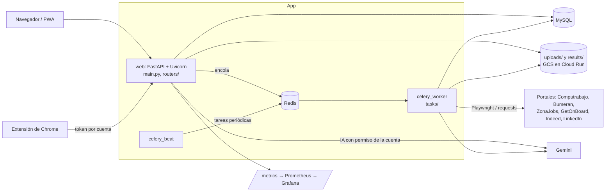

# Arquitectura

Mapa del sistema para quien llega al proyecto o tiene que diagnosticar un problema. Los pasos ante un
incidente están en [runbook.md](runbook.md).

## Componentes

| Componente | Código | Qué hace |
|---|---|---|
| Web | `main.py`, `routers/`, `templates/`, `static/` | FastAPI: páginas, API `/api/*`, login, CSRF, límites de pedidos y cabeceras de seguridad. `app.py` (Flask) solo aporta la config, la clave y la cookie de sesión |
| Worker | `celery_app.py`, `tasks/` | Búsquedas en portales, tareas de IA, emails, notificaciones y privacidad |
| Beat | `celery_app.py` (`beat_schedule`) | Recordatorios diarios, alertas de empleo (`ALERTS_INTERVAL_HOURS`), resumen semanal, retención de CVs, cuentas inactivas, limpieza de temporales |
| Scrapers | `scrapers/`, `scraping_jobs.py`, `job_dispatch.py` | Un scraper por portal; `SCRAPER_BACKEND=thread` (en la web) o `celery` (en el worker). La búsqueda universal unifica las ofertas repetidas (`job_dedup.py`) |
| Matching | `resume_parser.py`, `job_matcher.py`, `embeddings.py`, `job_ranking.py` | CV → habilidades y años; match TF-IDF o embeddings (`MATCHING_BACKEND`, `MATCHING_BACKEND_BY_LANGUAGE`); ranking aprendido de "me interesa" |
| IA | `ai_engine.py`, `ai_usage.py` | Gemini con caché, presupuesto diario y permiso por cuenta |
| Cuentas y seguridad | `accounts*.py`, `auth*.py`, `two_factor.py`, `passkeys.py`, `security_*` | Cuentas, sesiones, 2FA, passkeys, eventos de seguridad |
| Datos | `models.py`, `alembic/`, `db_config.py` | SQLAlchemy sobre MySQL; el esquema solo cambia con migraciones de Alembic |
| CVs | `cv_storage.py` | Cifrado en reposo (`CV_ENCRYPTION_KEY`) y retención (`CV_RETENTION_DAYS`) |

## Flujos principales

- **Búsqueda:** formulario → `job_dispatch.launch()` → scraper (thread o Celery) → CSV en `results/<cuenta>/` → `/view/<archivo>` lo muestra ordenado por match y ranking. El progreso vive en `job_status` (`services/state.py`); con Celery lo copia `job_dispatch.refresh()`.
- **CV:** subida → `cv_storage` lo cifra → `resume_parser` extrae habilidades y años → perfil por rol en `user_profiles` (`profile_store.py`).
- **Alertas:** beat → `run_job_alerts` → busca, filtra lo ya avisado y manda email, Telegram o push.
- **Extensión:** se vincula desde Mi cuenta; guarda ofertas en `/api/tracker/save-from-extension` con su token.

## Despliegue

| Ambiente | Cómo corre |
|---|---|
| Local | `docker compose up`: `migrate`, `web`, `celery_worker`, `celery_beat`, `redis`, `mysql`; perfil `monitoring` suma Prometheus y Grafana |
| GCP (`terraform/`) | Cloud Run (`empleoia_web`), worker pool de Cloud Run (`celery`), job `migrate`, Cloud SQL MySQL con IP privada, Memorystore Redis con contraseña, buckets GCS montados, Secret Manager, Artifact Registry |

Staging se despliega en cada push a `main`; producción solo desde un tag `vX.Y.Z` ([releases.md](releases.md)).

## Observabilidad

- `/api/health`: proceso vivo, versión y commit. `/api/ready`: base y Redis (lo usan el startup probe y el uptime check).
- Métricas en `/metrics`, tablero de Grafana y alertas: [observability.md](observability.md).
- Errores a Sentry con `SENTRY_DSN`; trazas OpenTelemetry con `OTEL_EXPORTER_OTLP_ENDPOINT`.
- Alertas de Cloud Monitoring (`terraform/monitoring.tf`): `/api/ready` caído, más de 5 % de 5xx, p95 mayor a 5 s y disco de Cloud SQL sobre 85 %.
- SLOs (`terraform/slo.tf`): 99,5 % de pedidos sin 5xx y 95 % en 1 s o menos sobre 28 días, con alertas por consumo del presupuesto de errores.

## CI

`python-app.yml` corre en cada PR: Ruff y mypy, tests unitarios, integración con MySQL, Redis y Playwright (incluye axe), carga con Locust, comparación visual, OWASP ZAP, contrato de la API con Schemathesis, Bandit, pip-audit, gitleaks, Trivy y SBOM. Otros workflows: `scraper-health.yml` (monitor diario de portales), `matching-compare.yml`, `backup-restore-check.yml`, `terraform.yml`, `deploy.yml` y `release.yml`.
